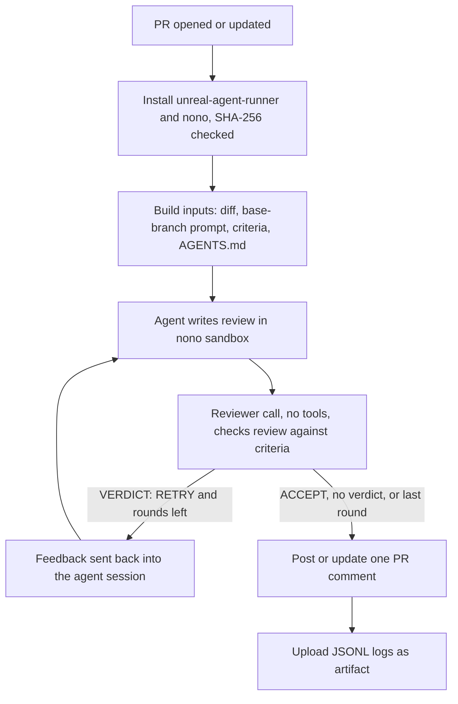

# unreal-agent-pr-review

A GitHub Actions workflow that reviews pull requests with
[Unreal Agent](https://github.com/unreallabsai/unreal-agent) and posts the review as a PR comment.
The agent runs inside a [nono](https://github.com/nolabs-ai/nono) sandbox and cannot change files,
reach the network, or read the API key.

This is a GitHub template repository. Click **Use this template** to start a new repo with it,
or copy the files below into an existing repo.

## Files

| Path | Purpose |
|---|---|
| `.github/workflows/unreal-agent-review.yml` | The workflow. |
| `.github/unreal-agent/pr-review.md` | Review task: inputs, method, output format. |
| `.github/unreal-agent/review-criteria.md` | Acceptance criteria that a second model call checks the review against. |
| `AGENTS.md` (optional, yours) | Repository rules. The agent checks each change against them. |

## Setup

1. Copy the `.github` directory into your repository, or create the repo from this template.
2. Add the repository secret `ANTHROPIC_API_KEY` (Settings → Secrets and variables → Actions).
3. Optional: add an `AGENTS.md` with your repository rules at the repository root.
4. Merge these files to the default branch. The workflow reads the prompt and criteria from the
   PR's base branch, so it fails on PRs whose base does not have them yet.
5. Open a pull request from a branch in the same repository.

## How it works

- **Rounds.** The agent and the reviewer check run up to `MAX_REVIEW_ROUNDS` times (default 3).
  The comment states whether the review passed the check.
- **One comment.** The workflow finds its own comment by a hidden marker and updates it on each push.
- **Logs.** All JSONL event logs and the final review go to the `unreal-agent-review-<PR>` artifact.
  The job summary shows the review and token totals.

## Security model

- **Trusted inputs come from the base branch.** The prompt, criteria, and `AGENTS.md` are read
  with `git show $BASE_SHA:...`, so a PR cannot weaken its own review.
- **Author text is data, not task.** The PR title and description go into read-only files.
  The task text only names their paths and marks them untrusted.
- **Four directories.** The agent's workspace and the inputs are read-only. The session store is
  the only writable grant besides `/tmp`. The task, criteria, logs, and review sit in a directory
  the sandbox cannot see, so the agent cannot change anything a later step trusts.
- **The key never enters the sandbox.** nono holds `ANTHROPIC_API_KEY` in its proxy and gives the
  sandbox a session token. The proxy allows only `POST /messages` on `api.anthropic.com`.
  Landlock blocks all other connections.
- **Skipped PRs.** Drafts, fork PRs, and Dependabot PRs are skipped. Fork and Dependabot PRs get no
  secrets, and drafts still change.
- **Pinned downloads.** `unreal-agent-runner` and nono are pinned versions, checked against the
  SHA-256 sums from their releases.
- **Least privilege.** The job token has `contents: read` and `pull-requests: write`.
  The checkout does not keep credentials.

## Configuration

Set these in the workflow's `env` block.

| Variable | Default | Meaning |
|---|---|---|
| `UNREAL_AGENT_VERSION` | `0.3.1` | Runner release. Update the two SHA-256 values with it. |
| `UNREAL_HARNESS_LLM_MODEL` | `claude-sonnet-5-5` | Anthropic model for the agent and the reviewer check. |
| `MAX_REVIEW_ROUNDS` | `3` | Most agent and reviewer-check rounds per run. |
| `NONO_VERSION` | `0.79.0` | nono release. Update the two SHA-256 values with it. |

- **Runner.** Needs Debian or Ubuntu (`dpkg`, `apt-get`, `sudo`) and Landlock (Linux 5.13 or later),
  on amd64 or arm64. Change `runs-on` for a self-hosted runner.
- **Lockfiles.** The `paths` list in "Prepare review inputs" leaves common lockfiles out of the diff.
  Edit it for your stack.
- **Review format.** Edit `pr-review.md` and `review-criteria.md` together. The criteria must match
  the output format that the prompt asks for.

## Updating pinned versions

1. Set the new version in the workflow.
2. Copy the `linux_amd64` and `linux_arm64` sums from the release's `SHA256SUMS` (Unreal Agent)
   or `SHA256SUMS.txt` (nono) into the matching `*_SHA256_*` variables.

## License

MIT. See [LICENSE](LICENSE).
